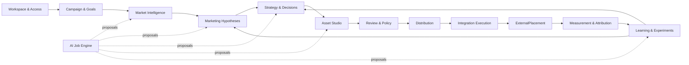

# Domain map

Статус: **Target architecture / Proposed**. Границы модулей описывают ответственность; это не требование выделять отдельный сервис на каждый домен. См. [vision](vision.md) и [ADR 002](../adr/002-modular-monolith.md).

## Домены и владельцы данных

| Домен / модуль | Владеет | Контракт с остальными |
| --- | --- | --- |
| Workspace & Access Control | Workspace, membership, capabilities, configured DeliveryTarget identities | Обязательный scope всех vNext-команд и deny-by-default access; credential secret не входит в domain DTO |
| Campaign & Goals | Кампания, цель, KPI definition, ограничения, период | Контекст кампании и критерии результата |
| Market Intelligence | Research brief/report, competitor intelligence, SEO-запросы, источники | Версия исследования, доказательства и пробелы |
| Marketing Hypotheses | `MarketingHypothesis` и immutable `HypothesisVersion`, assumptions, ожидаемый KPI effect и lifecycle проверки | Точная проверяемая формулировка, которую используют стратегия, assets, experiments и decisions |
| Strategy & Decisions | Strategy/StrategyVersion и Decision | Утверждённый способ проверки exact hypothesis version, ссылки на доказательства и следующие команды |
| Asset Studio | Asset/AssetVersion, статья, email, social-варианты, illustrations and creative assets, provenance | Точные версии текста/медиа, связь с HypothesisVersion и связи производных материалов |
| Review & Policy | Approval, права, ограничения бюджета/действий | SUBJECT approval exact version и EXECUTION approval exact IntentRevision |
| Distribution | DistributionIntent и его revisions, DeliveryAttempt, ExternalPlacement, reconciliation | План доставки и факты внешних результатов |
| Measurement & Attribution | Observation, KPI evaluation, attribution configuration/snapshot | Нормализованные наблюдения и интерпретация с ограничениями |
| Learning & Experiments | Experiment, предложения corrective actions, результат проверки HypothesisVersion | Предложение следующего решения; принятие хранится в Strategy & Decisions, исполнение идёт через владельца команды |
| AI Job Engine | AIJob/AIJobAttempt, execution snapshots, budgets, leases | Управляемое выполнение и валидируемый результат, не публикация |
| Integration Execution | Типизированные provider adapters и разрешённые capabilities | Выполнение только выданного действия и безопасный результат |
| Application Read Models | Проекции кампании, гипотезы, asset review, delivery timeline и evidence | Серверные DTO со статусами, доступными действиями и свежестью |

Workspace — корневая security boundary, а Campaign — business scope. `created_by` не заменяет membership check. Контроль доступа, аудит и transactional outbox — общая инфраструктура. Они не превращают произвольный модуль в владельца чужой таблицы. Внутри монолита модуль вызывает прикладной контракт владельца, а не пишет напрямую в его состояние.

## Поток работы

Стрелка обозначает разрешённую передачу результата или прикладную команду, а не общий mutable объект. Человек участвует в утверждении `HypothesisVersion`, принятии стратегии, согласовании версий и разрешении внешних действий.

## Инварианты гипотезы

- `MarketingHypothesis` — стабильная identity, а `HypothesisVersion` — неизменяемая проверяемая формулировка.
- Research, Strategy, Asset, Experiment и Decision ссылаются на exact version; ссылка на «текущую гипотезу» недостаточна для аудита.
- Новая version сохраняет causal identity; новая audience/problem/intervention/mechanism, делающая evidence несопоставимыми, создаёт новую MarketingHypothesis.
- StrategyVersion может менять способ проверки, не мутируя HypothesisVersion.
- Decision различает `SUPPORTED`, `NOT_SUPPORTED`, `INCONCLUSIVE`, `SUPERSEDED`; он не исполняет следующее действие.
- Один Experiment проверяет явно перечисленные hypothesis versions и не становится универсальным разрешением внешних действий.

## Каналы и маркетинговые возможности

| Возможность | Принадлежность и граница |
| --- | --- |
| Статьи на сайте | Asset Studio хранит утверждённую статью и SEO-поля; Distribution управляет намерением размещения; CMS adapter выполняет разрешённое действие |
| CMS publishing | Различает `WEBSITE_DRAFT_CREATE`, `WEBSITE_PUBLISH` и `WEBSITE_UPDATE`. Наличие draft ID не доказывает публичную публикацию |
| Email marketing | `EMAIL_TEST_SEND` и `EMAIL_CAMPAIGN_SEND` — разные действия. Версия письма и AudienceSnapshot immutable; provider acceptance не равно доставке каждому адресату |
| SEO | Исследование intent/тем/конкурентов, метаданные статьи и наблюдения индексации/поискового трафика; поиск позиции не выдаётся за бизнес-конверсию |
| Competitor intelligence | Датированные наблюдения публичных источников, допустимый сбор, ссылки и степень уверенности; вывод AI сохраняется отдельно от факта |
| Illustrations and creative assets | Версия изображения, alt text, provenance и сведения о разрешённых правах использования; asset привязан к точной версии статьи/варианта |
| Social channels | `SOCIAL_PUBLISH` использует общий lifecycle и provider-specific подтверждение; ограничения формата остаются в adapter/policy |
| Analytics and attribution | События сайта/CRM и канальные метрики имеют источники и качество. Attribution — выбранная модель с версией, а не доказанная причинность |
| Corrective actions and experiments | Решение может предложить новый текст, время, аудиторию или `HypothesisVersion`; публикация, расходы и запуск эксперимента требуют соответствующих полномочий |

Новый канал не должен требовать копии доменного workflow или собственной «истины» о согласовании. Однако единый интерфейс не стирает разницу между публикацией CMS-страницы, отправкой email и созданием social post.

## AI Job Engine

Пользовательская бизнес-задача описывает требуемый результат. AIJob описывает долговечное разрешённое вычисление; AIJobAttempt — конкретное обращение к модели. Job ссылается на точные входные версии, prompt/model/tool snapshots, initiator, разрешённую область, budget, deadline и generation key.

Retry создаёт новую attempt в том же job только при неизменном input/policy и наличии budget. Cancel запрещает новые provider requests; поздний result сохраняется для cost/audit, но не продвигает domain workflow. PostgreSQL фиксирует job до доставки сообщения; outbox делает его доступным для исполнителя. Дубли сообщений не создают вторую принятую генерацию. Внешняя публикация через AI tools запрещена.

## Approval и внешние действия

SUBJECT approval фиксирует exact version/hash. EXECUTION approval фиксирует exact IntentRevision: action kind, AssetVersion, DeliveryTarget, AudienceSnapshot, schedule/window, payload hash и policy version. Schedule-only change по умолчанию требует нового execution approval; transport retry того же revision не становится новым Intent. `UNKNOWN` блокирует повтор до reconciliation.

## Credential isolation

API, frontend, AI workers, read models и содержимое очередей не получают provider secrets. Integration Execution получает только необходимые credentials для конкретного разрешённого target и capability; доступы разных providers разделяются. Очередь содержит идентификаторы записей, а не токены или полные списки адресатов. Даже read-only сбор внешних данных требует scoped capability и собственного учёта запросов; он не выполняется при обычном открытии страницы UI.

## Связь с существующей системой

Campaign, ContentItem/ContentVersion, Approval, Task/AgentRun и Publication сохраняются в действующем write path до миграционных gates. Предложенные модули вводятся вокруг них через adapters/read projections; ни таблицы, ни процессы не переименовываются decision PR. Точное соответствие и единственный владелец записи на каждом шаге заданы в [migration strategy](migration-strategy.md).

Решения A1 contracts: [ADR 007](../adr/007-workspace-access-boundary.md), [ADR 008](../adr/008-version-identities-and-provenance.md), [ADR 009](../adr/009-action-kinds-and-deduplication.md), [ADR 010](../adr/010-approval-scopes-and-delegation.md), [ADR 011](../adr/011-ai-job-attempts-and-budgets.md), [ADR 012](../adr/012-hypothesis-lifecycle.md).
