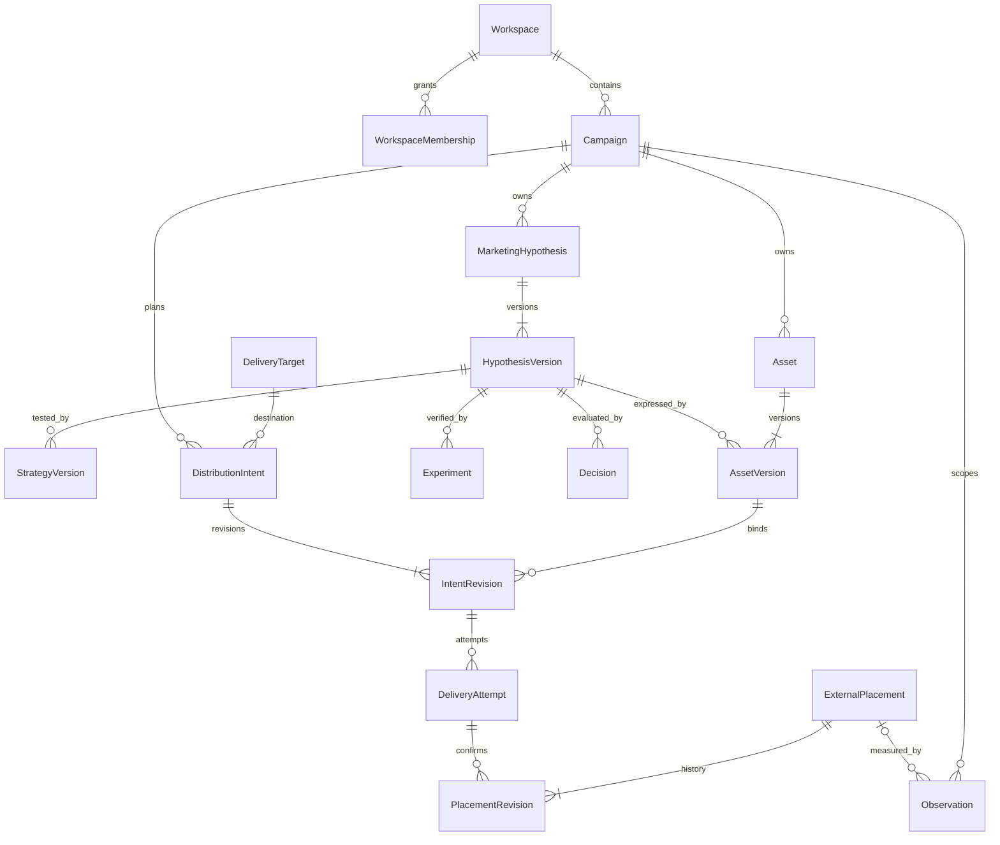

# Entity model

Статус: **Target architecture / Proposed**. Это концептуальные контракты и инварианты; имена полей ниже не являются SQL DDL, миграцией или обещанием уже существующего API. [ADR 003](../adr/003-versioned-assets.md), [ADR 004](../adr/004-intent-attempt-result.md), ADR 007–012.

## Workspace, контекст, гипотезы, доказательства и активы

| Сущность | Содержание и связи |
| --- | --- |
| Workspace | Корневая security boundary. Первый production scope содержит один default workspace; все vNext-aggregate имеют обязательный `workspace_id` |
| WorkspaceMembership | User, workspace role/capabilities, active/revoked state и audit metadata; service identities управляются отдельно |
| DeliveryTarget | Workspace-scoped identity заранее настроенного CMS/email/social target и разрешённых capabilities; хранит credential reference, но не secret |
| Campaign | Одна маркетинговая инициатива внутри Workspace, владелец, цель, период и ограничения; связывает остальные campaign-bound сущности |
| Goal / KPIDefinition | Бизнес-результат, определение показателя, единица, baseline, target, период, источник и правило attribution/deduplication |
| MarketingHypothesis | Стабильная identity одной причинной идеи внутри Campaign; operational lifecycle `DRAFT/ACTIVE/PAUSED/CLOSED/ARCHIVED` |
| HypothesisVersion | Immutable формулировка: аудитория, проблема, intervention, causal mechanism, ожидаемый KPI effect, assumptions, критерий проверки, ограничения и evidence references |
| Research / ResearchVersion | Brief и immutable отчёт по конкурентам/SEO: запросы, источники, время сбора, gaps, выводы и уверенность; typed link к exact HypothesisVersion |
| Strategy / StrategyVersion | Immutable выбор сообщений, каналов, ресурсов и способа проверки одной или нескольких exact HypothesisVersion; ссылки на версии исследований |
| Asset | Стабильная идентичность материала: ARTICLE, ILLUSTRATION, EMAIL, SOCIAL_POST или иной явно разрешённый тип |
| AssetVersion | Immutable содержимое и метаданные: title/body, SEO-поля либо media reference/hash, alt text, provenance, parent versions и exact HypothesisVersion |
| AssetRelation | Типизированная FK-связь точных версий: иллюстрация для статьи, email/social adaptation статьи; не ссылка на «текущий материал» |
| Approval | Immutable human decision. SUBJECT approval фиксирует exact version/hash; EXECUTION approval фиксирует exact IntentRevision, target, audience, schedule/window, payload и policy version |

PostgreSQL — source of truth для идентичностей, metadata, hashes, связей, согласований и истории. Бинарные creative assets могут находиться в immutable object storage; БД хранит точный object version/hash. Конкретное хранилище выбирается отдельно. Путь к изменяемому файлу не обеспечивает immutable версию.

Все Version rows immutable и имеют `(root_id, version_number)`, schema version и canonical snapshot hash. Current/head pointer допустим только для UI и optimistic concurrency; approval/execution всегда используют exact ID. Авторитетные relations реализуются typed FK tables, не произвольными JSON object IDs. Cross-workspace links запрещены; cross-campaign reuse создаёт derived identity/version в target campaign с provenance.

Новая формулировка гипотезы создаёт `HypothesisVersion`, пока сохраняется causal identity. Существенно иная audience/problem/intervention/mechanism создаёт новую `MarketingHypothesis`. Research/Observation, полученные после запуска, сохраняются отдельно и не редактируют исходное ожидание задним числом.

Изменение текста, title, иллюстрации, SEO-полей или канального варианта создаёт новую AssetVersion. Старые версии не редактируются. Одобрение v1 не распространяется на v2; создание v2 само по себе не отменяет разрешённую доставку v1.

## Намерение, попытка и результат

| Сущность | Минимальный контракт |
| --- | --- |
| DistributionIntent | Одно логическое внешнее действие; workspace, action kind, DeliveryTarget, stable business key, current revision и operational state |
| IntentRevision | Immutable subject действия: `asset_version_id`, action kind, exact target, AudienceSnapshot при наличии, schedule/window, payload hash, approval IDs, policy version, exact HypothesisVersion и revision fingerprint |
| DeliveryAttempt | Конкретная попытка по точной intent revision: attempt ID/number, execution token/lease, provider idempotency key, времена начала/завершения, classified outcome и safe diagnostics |
| ExternalPlacement | Идентичность подтверждённого объекта/размещения с provider, target, external ID, URL при наличии, временем/типом подтверждения и связью с доставкой |
| PlacementRevision | Подтверждённая связь внешнего объекта с конкретной AssetVersion и действием; нужна, например, при обновлении статьи по тому же CMS ID/URL |
| ReconciliationRecord | Append-only решение сверки неоднозначной попытки: доказательства, оператор, exact target/object identity и результат |

Canonical action kinds первого контура: `WEBSITE_DRAFT_CREATE`, `WEBSITE_PUBLISH`, `WEBSITE_UPDATE`, `EMAIL_TEST_SEND`, `EMAIL_CAMPAIGN_SEND`, `SOCIAL_PUBLISH`. Разрушительные действия вводятся отдельным contract/policy.

IntentRevision позволяет переносить расписание без подмены текста: новое время создаёт новую revision с тем же `asset_version_id`, если человек не выбрал новую редакцию отдельно. Business key сохраняется для logical action; transport retry не создаёт новый Intent. Замена version/target/audience/payload требует новой revision и execution approval. DeliveryAttempt всегда фиксирует revision до внешнего вызова. `UNKNOWN` блокирует retry до reconciliation.

Для email один campaign-send Intent связывает EmailVersion и immutable AudienceSnapshot. Provider acceptance/batch не называется recipient delivery. Recipient delivery/bounce/unsubscribe/click являются Observations; адреса не помещаются в общий outbox/audit.

Предлагаемые состояния не должны сводиться к одному полю `Publication.status`:

| Уровень | Примеры состояния | Что оно не доказывает |
| --- | --- | --- |
| Intent | DRAFT, WAITING_APPROVAL, SCHEDULED, CANCELLED, CLOSED | SCHEDULED не означает отправлен; CANCELLED не означает, что внешнего объекта никогда не было |
| Attempt | PREPARED, RUNNING, SUCCEEDED, FAILED, UNKNOWN | Timeout/потеря ответа не доказывают отсутствие внешнего эффекта |
| Placement | Подтверждённое создание/публичность; дальнейшие факты изменения/удаления | Историческое подтверждение не гарантирует доступность объекта сейчас |

`SUCCEEDED` требует валидного подтверждения именно запрошенного действия. CMS draft не удовлетворяет intent «публично опубликовать». У email provider acceptance не называется recipient delivery. Состояние целой доставки вычисляется с учётом action kind и уровня доказательства.

## Измерение, эксперимент и решение

| Сущность | Контракт |
| --- | --- |
| Observation | Immutable факт: metric/event, value/unit, source, observed/effective/collected times, period, quality, raw evidence reference/hash и campaign scope; может ссылаться на placement/asset/research/hypothesis version |
| AttributionSnapshot | Версия модели attribution и входных Observations, окно и правила deduplication; пересчёт создаёт новый snapshot |
| Experiment | Утверждённая проверка exact HypothesisVersion: control/variant, assignment unit, метрика, окно, budget, stop rules и связанные assets/intents |
| Decision | Human proposal/decision: question, alternatives, exact hypothesis/evidence/version IDs, rationale, actor, status, result `SUPPORTED/NOT_SUPPORTED/INCONCLUSIVE/SUPERSEDED`, expected KPI effect и следующие команды |

Observation не обязательно связана с ExternalPlacement: competitor intelligence, SEO и CRM могут давать самостоятельные факты. Неверное измерение исправляется новой записью с `supersedes`, а не ручной подменой истории. Unknown, missing и stale отличимы от нуля. Корреляция канального события с бизнес-KPI не объявляется причинностью.

Decision не мутирует HypothesisVersion и не исполняет corrective action. Новая версия/identity, Strategy, Experiment или DistributionIntent создаются отдельной прикладной командой.

## Исполнение и аудит

| Сущность | Назначение |
| --- | --- |
| AIJob | Логическое разрешённое вычисление: immutable input/output contract, generation key, prompt/model/tool policy snapshot, initiator, workspace/campaign, deadline и budget limits |
| AIJobAttempt | Конкретная model execution: ownership lease, request/usage/cost, status/error/result. Retry создаёт новую attempt; late cancelled result non-promotable |
| OutboxEvent | Сообщение, записанное в одной PostgreSQL-транзакции с бизнес-изменением; event ID, aggregate/revision IDs, schema version, delivery bookkeeping |
| AuditEvent | Actor/correlation/causation, тип решения, ссылки и времена; без provider secrets, приватных model payloads или email recipient lists |

AIJob budget фиксирует max attempts/provider requests, optional token/cost limits, deadline и tool limits. Перед каждым request остаток проверяется атомарно; unknown usage не считается zero. Изменение input/policy/schema создаёт новый AIJob. AI не получает external write tools и не принимает approvals.

Диаграмма показывает основные связи, не полный каталог FK. Нулевой результат попытки допустим; неоднозначный внешний эффект ждёт сверки. Доказательства импортированной legacy history сохраняют свой источник и неполноту.

## Обязательные инварианты

1. Все vNext aggregate имеют обязательный workspace scope; cross-workspace access/link deny-by-default.
2. Все ссылки на согласуемое/отправляемое содержимое и проверяемые гипотезы указывают на immutable version, не на `current_version`.
3. StrategyVersion, Experiment, Decision и применимый набор Observations фиксируют exact HypothesisVersion; последующая версия не подменяет исходный subject проверки.
4. Проверка approval и создание intent revision/outbox атомарны; право, active revision, отмена и время повторно проверяются непосредственно перед claim/send.
5. У одного logical action есть business key; transport retry не создаёт новый intent. Только одна действующая ownership lease допускает запуск attempt; просроченная lease сама по себе не разрешает retry UNKNOWN.
6. Confirmed provider identity уникальна в области provider + target + object kind + external ID. Одна URL или похожий title недостаточны для объединения материалов.
7. Публикация, отмена, сбой, исправление измерения и принятие решения сохраняют самостоятельную историю; projection не переписывает её под удобный status.
8. Время исполнения хранится как UTC instant с исходной IANA timezone/локальным выбором. DST gap/ambiguous local time требуют явного разрешения неоднозначности.
9. В БД и очередях хранятся credential references/capability scope, а не secrets. Персональные данные audience защищены отдельно от общих metadata.
10. Принятый AI-result уникален для logical generation key; queue duplicate не создаёт второй asset/hypothesis version. Cancelled/late attempt не продвигает business workflow.

Физическая схема, индексы и cardinality расширений уточняются отдельными implementation ADR/PR. Решения contract blockers закреплены в ADR 007–012; оставшиеся provider/retention/attribution вопросы перечислены в [roadmap](roadmap.md).
