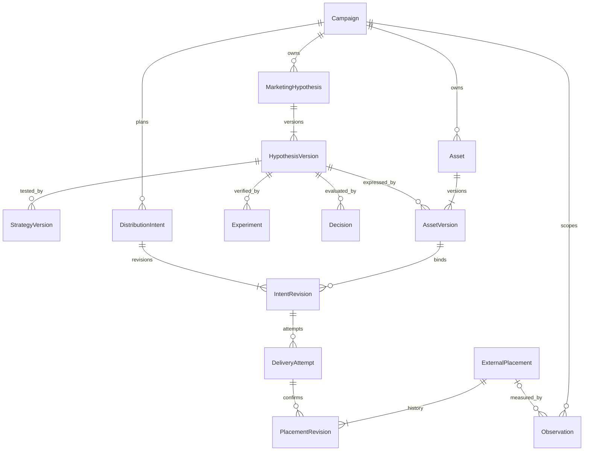

# Entity model

Статус: **Target architecture / Proposed**. Это концептуальные контракты и инварианты; имена полей ниже не являются SQL DDL, миграцией или обещанием уже существующего API. [ADR 003](../adr/003-versioned-assets.md), [ADR 004](../adr/004-intent-attempt-result.md).

## Контекст, гипотезы, доказательства и активы

| Сущность | Содержание и связи |
| --- | --- |
| Campaign | Одна маркетинговая инициатива, владелец, цель, период и ограничения; связывает остальные сущности |
| Goal / KPIDefinition | Бизнес-результат, определение показателя, единица, baseline, target, период, источник и правило attribution/deduplication |
| MarketingHypothesis | Стабильная identity проверяемой маркетинговой идеи внутри Campaign; владелец, lifecycle и история версий |
| HypothesisVersion | Immutable формулировка: аудитория, проблема, предполагаемый механизм, ожидаемый KPI effect, assumptions, критерий проверки, ограничения и evidence references |
| Research / ResearchVersion | Brief и immutable отчёт по конкурентам/SEO: запросы, источники, время сбора, gaps, выводы и уверенность; может поддерживать или опровергать exact HypothesisVersion |
| Strategy / StrategyVersion | Immutable выбор сообщений, каналов, ресурсов и способа проверки одной или нескольких exact HypothesisVersion; ссылки на версии исследований |
| Asset | Стабильная идентичность материала: ARTICLE, ILLUSTRATION, EMAIL, SOCIAL_POST или иной явно разрешённый тип |
| AssetVersion | Immutable содержимое и метаданные: title/body, SEO-поля либо media reference/hash, alt text, provenance, parent versions и exact HypothesisVersion |
| AssetRelation | Типизированная связь точных версий: иллюстрация для статьи, email/social adaptation статьи; не ссылка на «текущий материал» |
| Approval | Решение уполномоченного человека по точному subject snapshot/hash, scope, target и policy version; content, hypothesis, strategy и execution approvals различаются |

PostgreSQL — source of truth для идентичностей, metadata, hashes, связей, согласований и истории. Бинарные creative assets могут находиться в immutable object storage; БД хранит точный object version/hash. Конкретное хранилище выбирается отдельно. Путь к изменяемому файлу не обеспечивает immutable версию.

Новая формулировка гипотезы создаёт `HypothesisVersion`; существенно иная причинная идея создаёт новую `MarketingHypothesis`. Изменение StrategyVersion не переписывает HypothesisVersion. Research/Observation, полученные после запуска, сохраняются отдельно и не редактируют исходное ожидание задним числом.

Изменение текста, title, иллюстрации, SEO-полей или канального варианта создаёт новую AssetVersion. Старые версии не редактируются. Одобрение v1 не распространяется на v2; создание v2 само по себе не отменяет разрешённую доставку v1. Ссылки между версиями проверяются на принадлежность разрешённой кампании/workspace и отсутствие недопустимых циклов.

## Намерение, попытка и результат

| Сущность | Минимальный контракт |
| --- | --- |
| DistributionIntent | Стабильное намерение выполнить конкретное внешнее действие для кампании; `current_revision_id`, operational state и история решений |
| IntentRevision | Immutable subject действия: `asset_version_id`, action kind, exact target, schedule, payload hash, approval IDs, policy version, exact HypothesisVersion и business deduplication key |
| DeliveryAttempt | Конкретная попытка по точной intent revision: attempt ID/number, execution token/lease, provider idempotency key, времена начала/завершения, классифицированный исход и безопасная диагностика |
| ExternalPlacement | Идентичность подтверждённого объекта/размещения с provider, target, external ID, URL при наличии, временем/типом подтверждения и связью с доставкой |
| PlacementRevision | Подтверждённая связь внешнего объекта с конкретной AssetVersion и действием; нужна, например, при обновлении статьи по тому же CMS ID/URL |
| ReconciliationRecord | Append-only решение сверки неоднозначной попытки: доказательства, оператор, exact target/object identity и результат |

IntentRevision позволяет переносить расписание без подмены текста: новое время создаёт новую revision с тем же `asset_version_id`, если человек не выбрал новую редакцию отдельно. DeliveryAttempt всегда фиксирует revision до внешнего вызова. Отмена будущего intent не удаляет попытки или уже полученное ExternalPlacement.

Для website intent означает одно действие с конкретной CMS-страницей; для VK/Telegram — конкретный пост в конкретном сообществе/чате. Для email первый вертикальный срез моделирует одну отправку кампании по immutable audience snapshot. Provider request/batch имеет свою попытку; принятие рассылки и индивидуальная доставка/отказ/отписка имеют разные evidence. Политика разбиения email на batches и recipient-level учёт уточняются до реализации email, без хранения адресов в общей очереди.

Предлагаемые состояния не должны сводиться к одному полю `Publication.status`:

| Уровень | Примеры состояния | Что оно не доказывает |
| --- | --- | --- |
| Intent | DRAFT, WAITING_APPROVAL, SCHEDULED, CANCELLED, CLOSED | SCHEDULED не означает отправлен; CANCELLED не означает, что внешнего объекта никогда не было |
| Attempt | PREPARED, RUNNING, SUCCEEDED, FAILED, UNKNOWN | Timeout/потеря ответа не доказывают отсутствие внешнего эффекта |
| Placement | Подтверждённое создание/публичность; дальнейшие факты изменения/удаления | Историческое подтверждение не гарантирует доступность объекта сейчас |

`SUCCEEDED` требует валидного подтверждения именно запрошенного действия. CMS draft не удовлетворяет intent «публично опубликовать». У email provider acceptance не называется recipient delivery. Состояние целой доставки вычисляется с учётом action kind и уровня доказательства; ошибки старых attempts не отменяют подтверждённый последующий результат.

## Измерение, эксперимент и решение

| Сущность | Контракт |
| --- | --- |
| Observation | Immutable факт: metric/event, value/unit, source, observed/effective/collected times, period, quality, raw evidence reference/hash и campaign scope; может ссылаться на placement/asset/research/hypothesis version |
| AttributionSnapshot | Версия модели attribution и входных Observations, окно и правила deduplication; пересчёт создаёт новый snapshot |
| Experiment | Утверждённая проверка exact HypothesisVersion: control/variant, assignment unit, метрика, окно, budget, stop rules и связанные assets/intents |
| Decision | Предложение или принятое решение: question, alternatives, exact hypothesis/evidence/version IDs, rationale, actor, status, результат проверки, expected KPI effect и требуемые следующие команды |

Observation не обязательно связана с ExternalPlacement: competitor intelligence, SEO и CRM могут давать самостоятельные факты. Неверное измерение исправляется новой записью с `supersedes`, а не ручной подменой истории. Unknown, missing и stale отличимы от нуля. Корреляция канального события с бизнес-KPI не объявляется причинностью.

Decision по HypothesisVersion различает минимум `SUPPORTED`, `NOT_SUPPORTED`, `INCONCLUSIVE` и `SUPERSEDED` как концептуальные результаты; физический enum определяется отдельным implementation ADR. Принятие Decision не мутирует HypothesisVersion и не исполняет корректирующее действие. Новая версия или новая гипотеза создаются отдельной прикладной командой.

## Исполнение и аудит

| Сущность | Назначение |
| --- | --- |
| AIJob / AIJobAttempt | Долговечное вычисление и конкретная попытка модели; input/prompt/model snapshots, permissions, лимиты, ownership token, usage и результат валидации |
| OutboxEvent | Сообщение, записанное в одной PostgreSQL-транзакции с бизнес-изменением; event ID, aggregate/revision IDs, schema version, delivery bookkeeping |
| AuditEvent | Actor/correlation/causation, тип решения, ссылки и времена; без provider secrets, приватных model payloads или email recipient lists |

Диаграмма показывает основные связи, не полный каталог FK. Нулевой результат попытки допустим; неоднозначный внешний эффект ждёт сверки. Доказательства импортированной legacy history сохраняют свой источник и неполноту.

## Обязательные инварианты

1. Все ссылки на согласуемое/отправляемое содержимое и проверяемые гипотезы указывают на immutable version, не на `current_version`.
2. StrategyVersion, Experiment, Decision и применимый набор Observations фиксируют exact HypothesisVersion; последующая версия не подменяет исходный subject проверки.
3. Проверка approval и создание intent revision/outbox атомарны; право, актуальная revision, отмена и время повторно проверяются непосредственно перед claim/send.
4. У одного логического действия есть business deduplication key; transport retry не создаёт нового маркетингового намерения. Только одна действующая ownership lease допускает запуск попытки; просроченная lease сама по себе не разрешает повтор UNKNOWN.
5. Confirmed provider identity уникальна в области provider + target + object kind + external ID. Одна URL или похожий title недостаточны для объединения материалов.
6. Публикация, отмена, сбой, исправление измерения и принятие решения сохраняют самостоятельную историю; projection не переписывает её под удобный статус.
7. Время исполнения хранится как UTC instant с исходной IANA timezone/локальным выбором. DST gap/ambiguous local time требуют явного разрешения неоднозначности.
8. В БД и очередях хранятся credential references/capability scope, а не секреты. Персональные данные audience защищены отдельно от общих metadata.
9. Принятый AI-результат уникален для logical generation key; повторное сообщение не создаёт второй asset или hypothesis version. Отменённая AI-попытка не продвигает бизнес-workflow.

Физическая схема, индексы и cardinality расширений уточняются отдельными implementation ADR/PR; открытые вопросы перечислены в [roadmap](roadmap.md).
